<div align="center">


# Hlídač: Oncology Symptom Companion

**An accessible, Czech-language companion that notices when a patient gets worse between cancer treatment visits, gives them advice a clinician has approved, and sends the care team only the cases they really need to act on. Each of those cases comes with a deadline, an escalation path and a full audit trail, on HL7® FHIR® R4 in InterSystems IRIS for Health.**

Rakathon 2026 · challenge `praha-03` **Digitální hlídač nežádoucích účinků** (FN Motol a Homolka) · team **VI-KA**

`InterSystems IRIS for Health` · `FHIR R4` · `IRIS SQL` · `Interoperability production` · `Embedded Python` · `FastAPI` · `Azure OpenAI / local LLM` · `Whisper` · `WCAG 2.2 AA`

</div>

---

## Contents

1. [The problem](#1-the-problem)
2. [Our approach in one picture](#2-our-approach-in-one-picture)
3. [The patient's side](#3-the-patients-side)
4. [The nurse's side](#4-the-nurses-side)
5. [InterSystems IRIS at the centre](#5-intersystems-iris-at-the-centre)
6. [AI with guard rails: the LLM reads, the rules decide](#6-ai-with-guard-rails-the-llm-reads-the-rules-decide)
7. [Accessibility first](#7-accessibility-first)
8. [Security and privacy, proven by tests](#8-security-and-privacy-proven-by-tests)
9. [Clinical content and evidence](#9-clinical-content-and-evidence)
10. [Running it](#10-running-it)
11. [Repository map](#11-repository-map)
12. [Honest limits and the path forward](#12-honest-limits-and-the-path-forward)

---

## 1. The problem

Side effects of chemotherapy and other systemic anticancer therapy (SACT) often appear **weeks before the next visit**. The evidence for monitoring them in between is strong:

- In STAR (Basch 2016), symptom monitoring between visits **cut emergency visits from 41 % to 34 %** and improved quality of life.
- Done naively, it **floods nurses**. In PRO-TECT (Nature Medicine 2025, n = 1,191), **about 1 in 3 surveys raised an alert, and 47 % of nurses said there were too many.**
- Digital health tools also often **shut out the patients who need them most**: blind and low-vision users, people with tremor, older patients and people who find forms hard.

`praha-03` asks for three things: send patients a short side-effect questionnaire regularly, advise them how to cope, and alert the care team on its own when answers reach warning levels.

**What we did differently:**

| Usual ePRO app | Hlídač |
|---|---|
| Long forms | A **conversation**: the patient says how they feel in their own words, and the app asks **only what is still missing** |
| An AI chatbot decides | **The LLM only reads and quotes. Deterministic, versioned rules decide.** Every decision can be replayed. |
| Every red answer becomes an alert | **Fewer alerts, each with its reason**: the rule, the patient's quote, days since the dose (from the hospital's data) and a provisional CTCAE grade |
| An alert is sent and forgotten | **A closed loop**: owner, deadline, escalation to a fallback contact, resolution |
| Its own data silo | **Standard FHIR R4 in the hospital's own IRIS**, written next to the hospital's records |
| Accessibility added at the end | **Built first for patients with disabilities**, with an automated WCAG 2.2 AA check on every screen |

---

## 2. Our approach in one picture

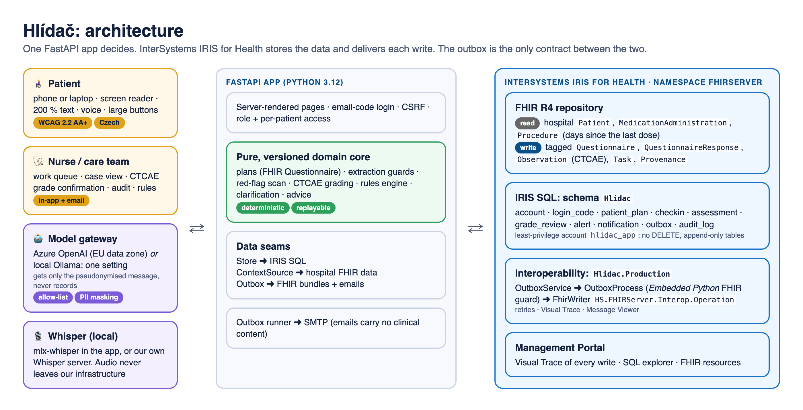

- **One app decides:** FastAPI with a pure, versioned domain core.
- **IRIS stores and delivers:** the hospital's FHIR data, our records written back as FHIR, our SQL tables, and the interoperability production that performs every FHIR write.
- **One outbox contract between them:** the app never writes to the FHIR repository directly.

**How a report flows:**
1. The patient writes, speaks or taps.
2. The app extracts findings, grades them and assesses the report **at once**.
3. The patient sees the result immediately: an urgent screen, the next question, an approved advice card, or "a nurse will review this".
4. An urgent result creates the alert row **before** anything else, so the nurse queue shows it immediately.
5. The app then queues one FHIR transaction bundle and the emails. `Hlidac.Production` checks the bundle again inside IRIS and writes it to the FHIR repository.

---

## 3. The patient's side

Our own web app, mobile-first and in Czech. No messenger and no third parties. The patient can answer in **three ways, all equal**: free text, voice, or large buttons. "Nevím" (I don't know) is offered on every question, and there are no time limits.

<table>
<tr>
<td align="center" width="25%">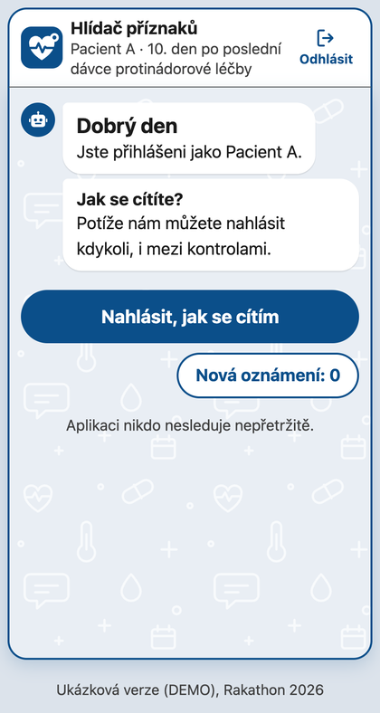<br><sub><b>Home.</b> Report how you feel at any time, also between check-ups. The app says plainly that nobody watches it around the clock.</sub></td>
<td align="center" width="25%">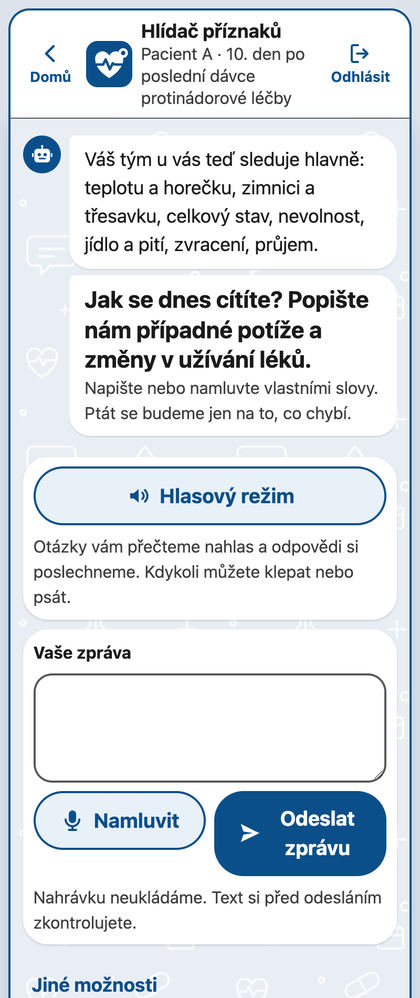<br><sub><b>The chat.</b> The header shows the day since the last dose, <b>read from the hospital's data in IRIS</b>. The patient sees what the team is monitoring.</sub></td>
<td align="center" width="25%">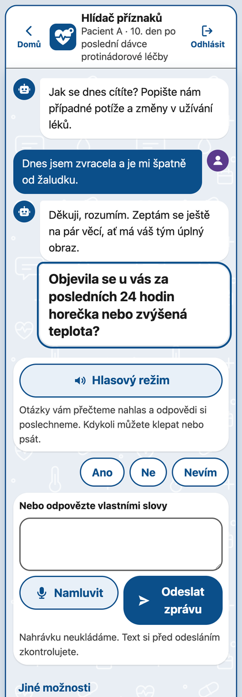<br><sub><b>One sentence in.</b> "I vomited today and feel sick." The model reads it, and the app asks <b>red flags first</b> (fever, chills…), each with buttons.</sub></td>
<td align="center" width="25%">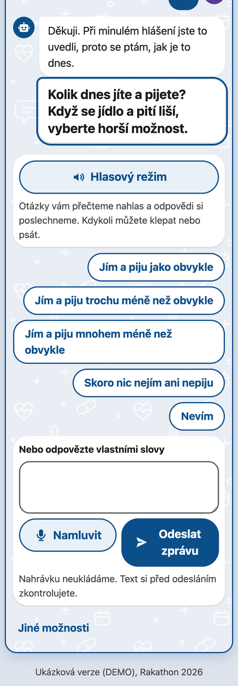<br><sub><b>Only what's missing.</b> Answer options come from the clinician's FHIR <code>Questionnaire</code>, as big quick-reply buttons.</sub></td>
</tr>
<tr>
<td align="center">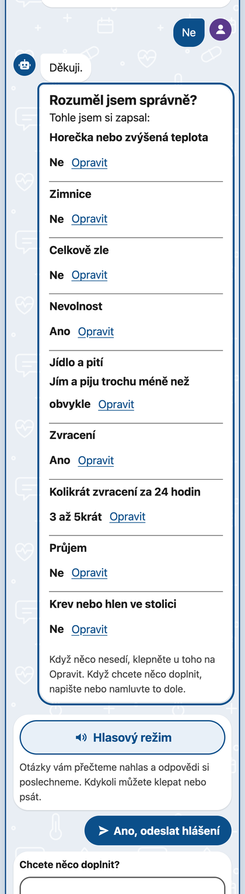<br><sub><b>"Did I understand you correctly?"</b> One check at the end, and every item can be corrected before sending.</sub></td>
<td align="center">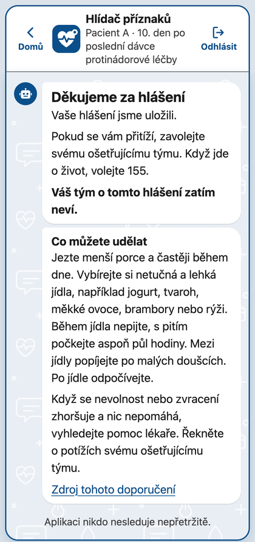<br><sub><b>Mild: advice.</b> Plain-language Czech advice that a clinician has approved, with its source, and a clear "your team doesn't know about this report".</sub></td>
<td align="center">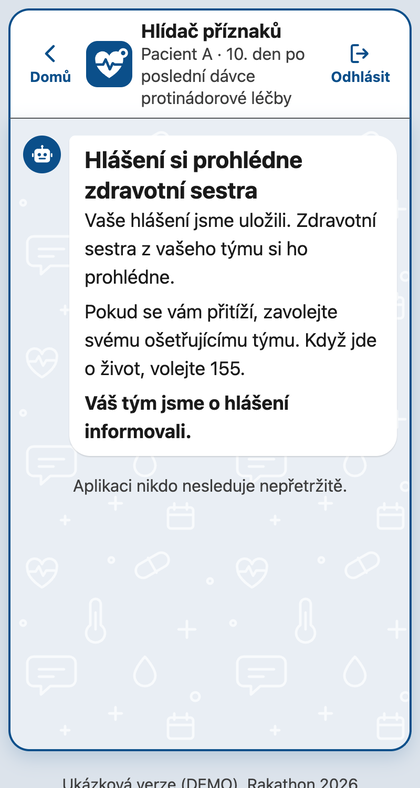<br><sub><b>Ambiguous: routine review.</b> "A nurse will look at your report", and the team has been told.</sub></td>
<td align="center">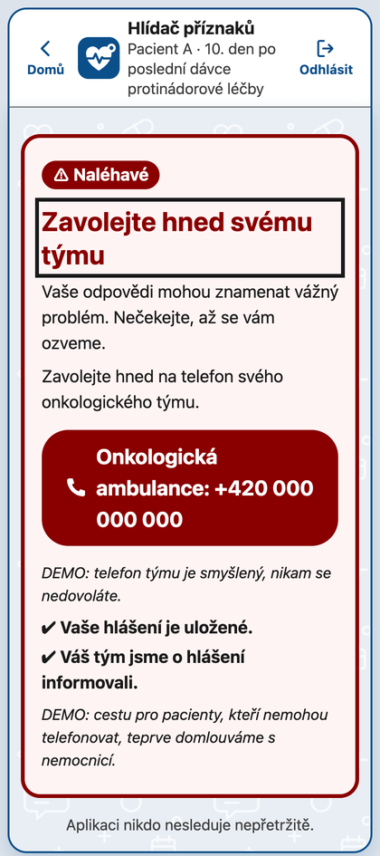<br><sub><b>Urgent: never waits.</b> "Fever 38.4 °C and chills" on day 10 after a dose → "Call your team now", the moment the patient confirms it.</sub></td>
</tr>
</table>

### Voice mode (hands-free)

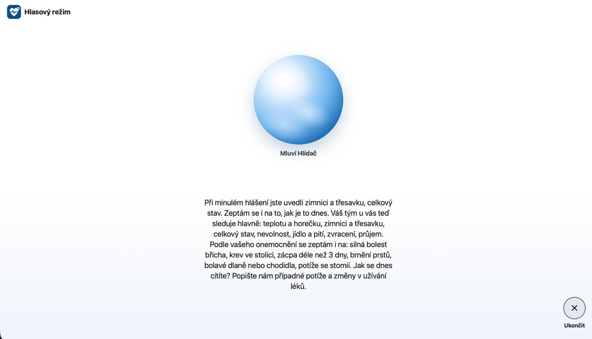

**"Hlasový režim"** runs the whole check-in by voice, for patients who can't read or tap easily:
- The device **reads each step aloud** with its own built-in Czech voice.
- It plays a short tone and listens until the patient stops talking.
- It reads back what it understood and sends the answer when the patient says "ano".
- The text includes what the patient reported last time and the questions for their **illness group**.
- Speech is transcribed by **Whisper on our own machine** (`mlx-whisper` in the app, or our own Whisper server). **Audio never goes to a third-party API.** The patient checks the text before it is sent.
- Tapping and typing keep working throughout.

---

## 4. The nurse's side

The nurse queue shows **only what needs action, and why**.

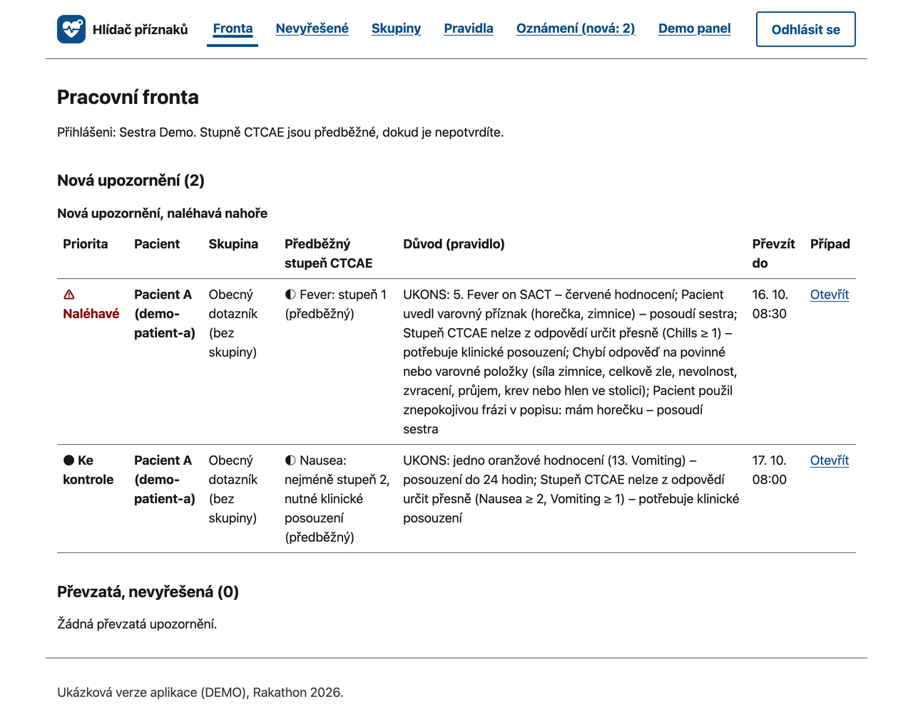

<table>
<tr>
<td width="50%">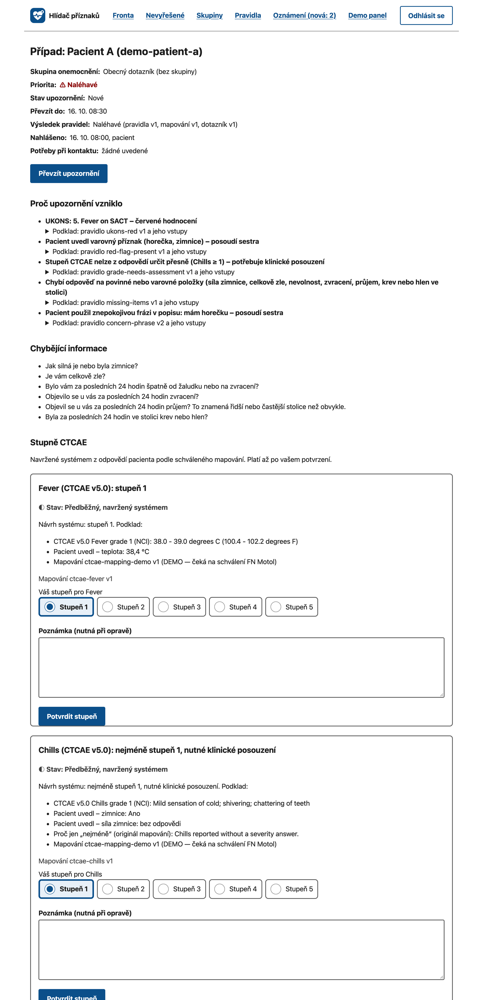<br><sub><b>The case view.</b> Why the alert exists: each rule that fired, with its version. Which information is missing. Each <b>provisional CTCAE v5.0 grade</b> with its basis (the verbatim NCI definition, the patient's own words) to confirm or correct. The symptom history across reports. The patient's own words with the quote each finding came from.</sub></td>
<td width="50%">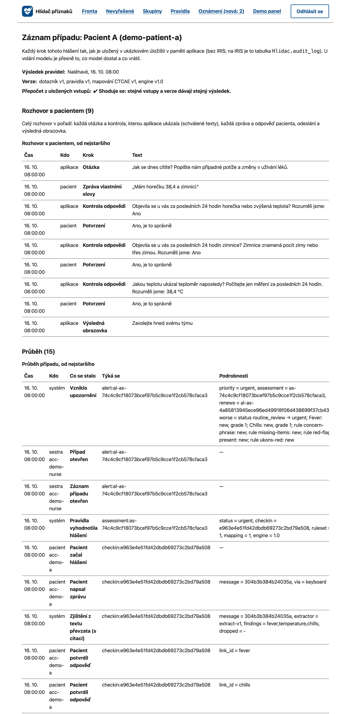<br><sub><b>The audit trail: "what the model saw".</b> The whole conversation as the patient saw it, every step of the case, and the exact input of each model call. <b>The replay check re-runs the rules on the stored inputs and versions and confirms "Shoduje se" (it matches).</b></sub></td>
</tr>
<tr>
<td>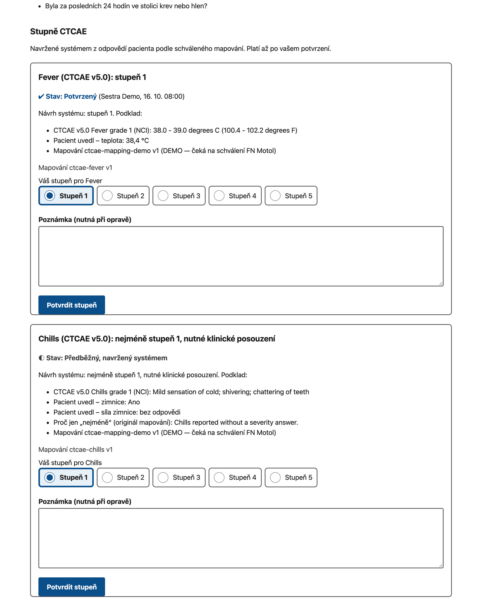<br><sub><b>A human confirms every grade.</b> The engine's grade stays <i>provisional</i> until a nurse confirms it, or corrects it with a note. In FHIR, the grade <code>Observation</code> goes <code>preliminary</code> → <code>final</code>.</sub></td>
<td>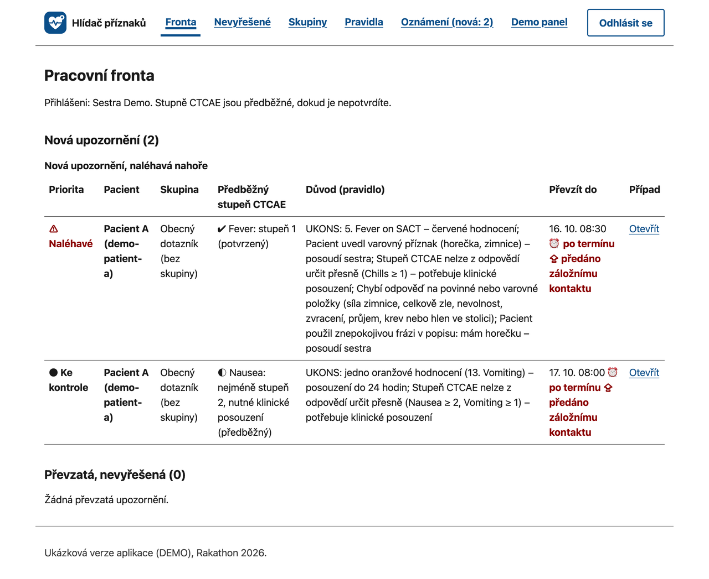<br>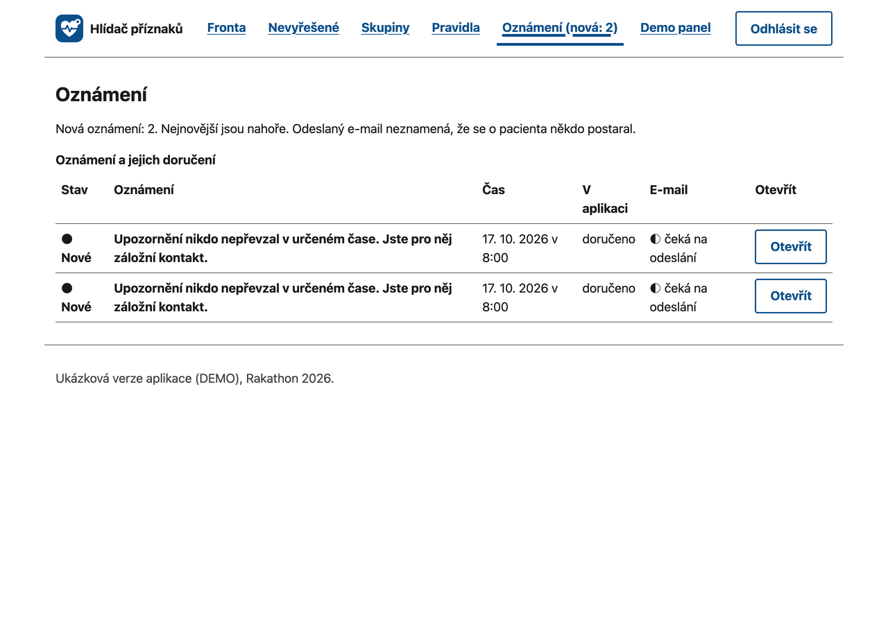<br><sub><b>Nobody took it? Escalation.</b> After the deadline passes, the team's fallback contact is told, in the app and by email. The emails carry no clinical content, only a link to the queue.</sub></td>
</tr>
<tr>
<td>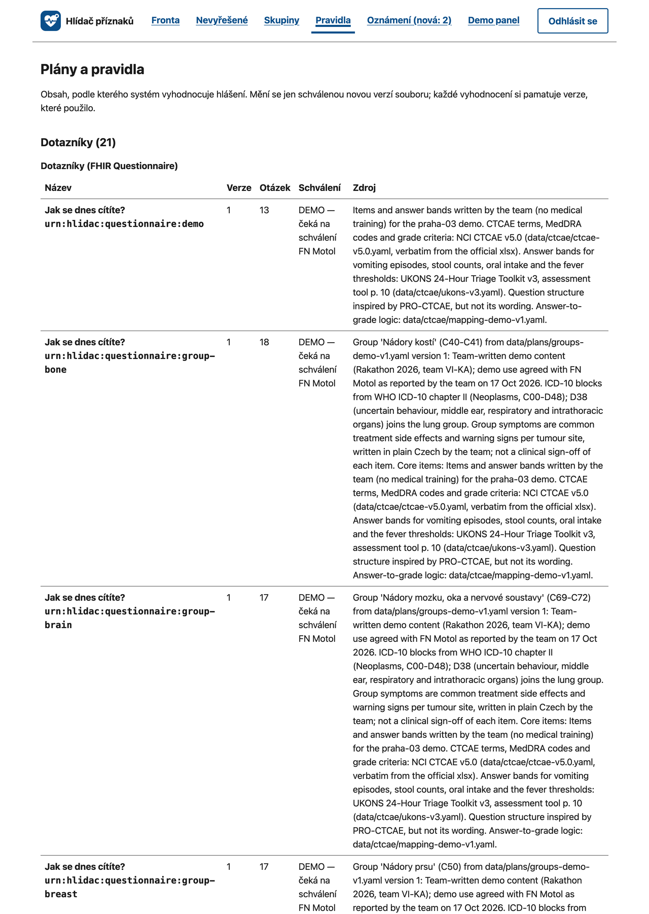<br><sub><b>Plans and rules, in plain view.</b> Every Questionnaire, ruleset and mapping with its version, source and approval status ("DEMO: awaiting FN Motol's approval").</sub></td>
<td>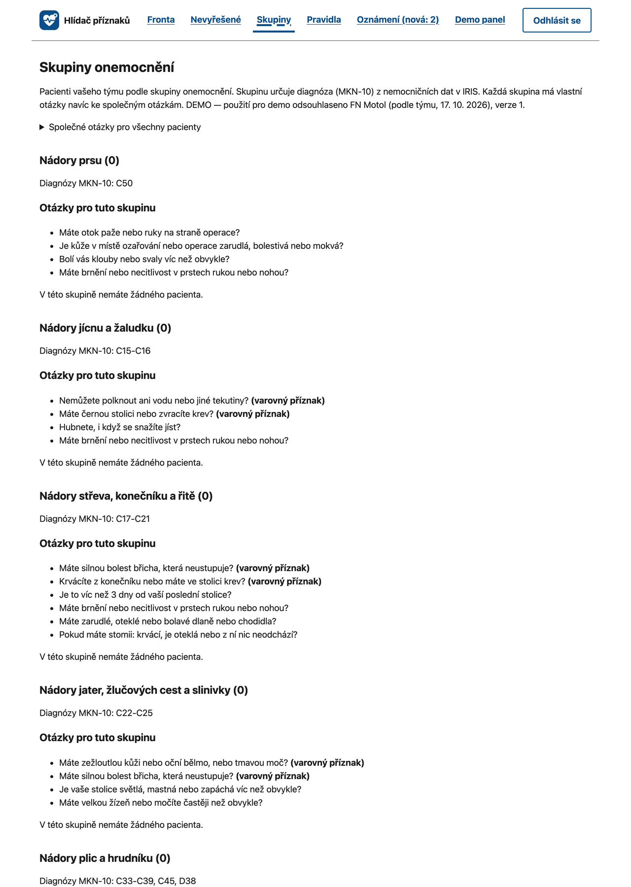<br><sub><b>20 illness groups by ICD-10.</b> Each group adds its own questions (and red flags) to the shared ones, based on the patient's diagnosis in the hospital data.</sub></td>
</tr>
</table>

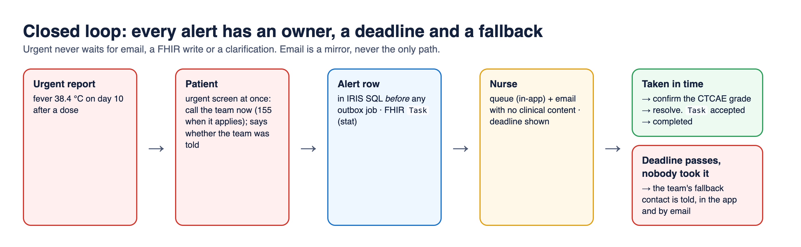

---

## 5. InterSystems IRIS at the centre

IRIS is **the whole data layer**. Every part of the architecture maps to an IRIS feature, and you can see each one in the Management Portal.

| IRIS feature | What Hlídač does with it |
|---|---|
| **FHIR R4 repository** (IRIS for Health) | Holds the **real hospital dataset** (read-only for us) and our records written back **as standard FHIR** next to it: `Questionnaire`, `QuestionnaireResponse`, CTCAE grade `Observation`s, alert `Task`s and `Provenance`. |
| **SQL over FHIR data** | The treatment context ("day 10 after the last dose") is read with **SQL from the FHIR search tables** (`MedicationAdministration` and the anticancer-therapy `Procedure`, VZP code 42520) in the same database. There is no export, no copy and no ETL. The patient record never leaves IRIS. |
| **IRIS SQL** (schema `Hlidac`) | The app's operational data: accounts, login codes, patient plans, check-ins, **append-only, replayable assessments**, grade reviews, alerts, notifications, **the outbox** and the **audit log** with exactly what each model saw. |
| **Interoperability production** `Hlidac.Production` | The **only component that writes to the FHIR repository**. `OutboxService` (an `Ens.InboundAdapter`) polls `Hlidac.outbox`. `OutboxProcess` checks each bundle and records the outcome. `FhirWriter` is IRIS for Health's own **`HS.FHIRServer.Interop.Operation`**, which writes the transaction bundle in-process. Failed rows are retried with backoff, then marked `failed` and shown in the nurse's "Unresolved" view. |
| **Embedded Python** | `Hlidac.Prod.Guard` runs our standard-library FHIR guard (`fhir_guard.py`) **inside IRIS** (`[Language = python]`). The same code that checks a bundle when the app queues it checks it **again just before it is written**. |
| **Security model** | A least-privilege IRIS account, `hlidac_app`: SELECT on only three hospital FHIR search tables, **no DELETE anywhere, no UPDATE on the append-only tables**, no FHIR API, no code execution. Tests prove each of these restrictions on a live IRIS. |
| **Management Portal** | The **Visual Trace** of every write, the Message Viewer, the FHIR resources and SQL queries over our tables. |

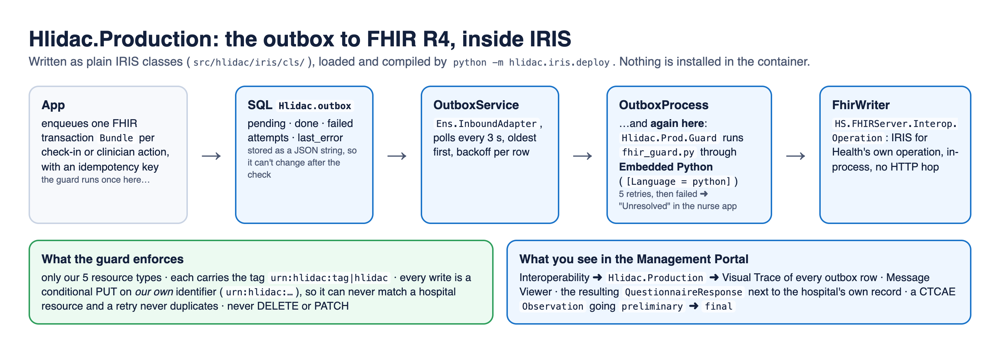

### FHIR as the data model, not only an export format

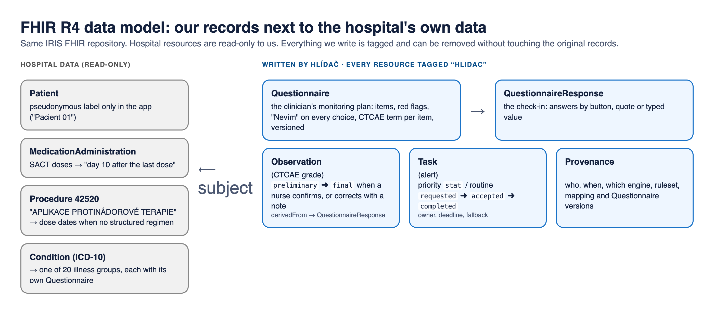

- **The monitoring plan is a FHIR `Questionnaire`.** Clinicians define the items, red flags, answer options, `enableWhen` logic and the CTCAE term for each item. There are 21 versioned Questionnaires: a general one plus one for each illness group.
- **Each check-in becomes a `QuestionnaireResponse`.** Each answer records whether it came from a button, a quote or a typed value.
- **Each CTCAE grade is an `Observation`** that goes `preliminary` → `final` when a nurse confirms it. It is `derivedFrom` the response.
- **Each alert is a `Task`** that goes `requested` → `accepted` → `completed`, with priority `stat` for urgent cases.
- **`Provenance` records who and what produced each resource:** the engine, ruleset, mapping and Questionnaire versions.

**Safe write-back, guaranteed by the guard:**
- Only our five resource types are allowed, and each carries the tag `urn:hlidac:tag|hlidac`.
- Every write is a **conditional PUT on our own identifier** (`urn:hlidac:…`). A write can therefore **never match a hospital resource**, and a retry **never creates a duplicate**.
- DELETE and PATCH are never allowed.
- A reset removes only our tagged resources and SQL rows, and **checks that the hospital resource counts did not change**.

**Verified end to end on the team's IRIS server with the real hospital dataset** (Sat 17 Oct 2026): all three demo scenarios ran. The production made 6/6 FHIR writes and the app sent 9/9 emails, with 0 errors. A grade went `preliminary` → `final`, and an alert escalated to the fallback contact after +1 h. Patients appear only under pseudonymous labels ("Pacient 01…05").

---

## 6. AI with guard rails: the LLM reads, the rules decide


**The model's job:**
- Fill a strict JSON schema generated from the FHIR Questionnaire.
- Back every finding with a **verbatim quote** from the patient's message. A finding without a matching quote is dropped.
- Nothing else: **no model sets urgency or a grade, and no model writes text the patient sees.**

**Guards around it:**
- **Model gateway with an allow-list.** Patient text can reach only the approved Azure OpenAI deployment (EU data zone) or a **local model (Ollama), switched by one setting**. Audio reaches only local Whisper. A call to any other endpoint **raises an error**, and tests cover this.
- **Pseudonymisation** before every non-local call: names, Czech birth numbers, phone numbers, emails and addresses are masked. **The model gets only the current message and the Questionnaire items**, never records, IDs, dates or treatment context.
- **Deterministic red-flag phrase scan.** Phrases are cited from published sources. A hit can only **raise** urgency.
- **Uncertainty never lowers urgency.** `absent`, `not_mentioned` and `unknown` are distinct states. "Nevím" means *unknown*, never *no*. A missing red-flag answer can never end as "no escalation". A missing attribute never lowers a CTCAE grade; the grade becomes "at least N".
- **Replayable decisions.** Each assessment stores snapshots of its inputs and the version of every file it used. The audit screen re-runs it and confirms that it matches.

The full order of the assessment and the guards G1–G8 are in [`architecture/system-design.md`](architecture/system-design.md) §6. The non-negotiable principles are in [`PRINCIPLES.md`](PRINCIPLES.md).

---

## 7. Accessibility first

Hlídač is designed for patients with disabilities **from the first screen** ([`architecture/accessibility.md`](architecture/accessibility.md)):

<table>
<tr>
<td align="center" width="33%">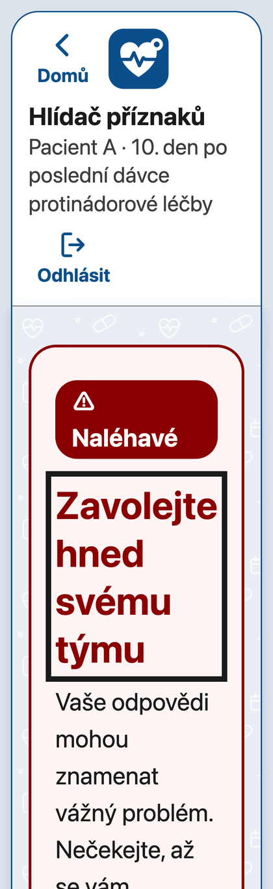<br><sub><b>200 % text.</b> The urgent screen still reflows to one column, with no horizontal scrolling.</sub></td>
<td align="center" width="33%">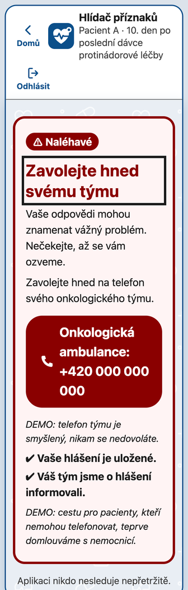<br><sub><b>320 px wide</b> (400 % zoom). Everything still fits.</sub></td>
<td align="center" width="33%">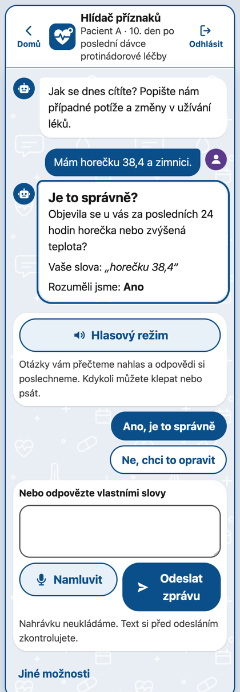<br><sub><b>Red flags read by the model are confirmed by a button</b> before the urgent screen: "Your words: … We understood: Yes. Is that right?"</sub></td>
</tr>
</table>

- WCAG 2.2 AA on every page, and **AAA contrast (7:1)** in the patient flow. Status is never shown by colour alone.
- Touch targets are at least 48 × 48 px. There are no gestures and no time limits, and answers are saved after every step.
- Semantic HTML rendered on the server. It works with a screen reader (tested with VoiceOver) and with the keyboard alone, and the urgent screen moves focus to its heading.
- Plain, approved Czech text, with no jargon and no CTCAE grades on patient screens.
- **Automated proof:** a Playwright + axe-core run walks the whole check-in in a real browser and checks every patient and nurse page. It also checks target sizes and reflow at 320 px and at 200 % text (`tests/a11y/`).

---

## 8. Security and privacy, proven by tests

| Control | How it is proven |
|---|---|
| Passwordless email-code login (6 digits, 10 minutes, single use, locked after 5 wrong tries, rate-limited) | `tests/security/` |
| Role checks and per-patient access ("patient A can't read patient B") on every route | A test fails if any non-public route has no login check |
| CSRF protection on every form and script call | `tests/security/` |
| Model gateway allow-list and pseudonymisation | `tests/test_models.py` |
| Least-privilege IRIS account (no DELETE, append-only tables, nothing outside our schema, no FHIR API) | IRIS tests run against a separate `HlidacTest` schema |
| A tampered FHIR bundle is refused, and a duplicate is written only once | IRIS production end-to-end test |
| Emails carry no clinical content, and a login-code email is redacted once sent | `tests/test_outbox_runner.py` |

**Over 950 automated tests** (966 passing outside the browser suite) cover the rules, the red flags, "uncertainty never lowers urgency", access control, CSRF, the gateway, the FHIR mapping, the production and accessibility.

**Real patient data stays in IRIS.** It is never in git, logs, URLs or a cloud tool. The only exception is the patient's own pseudonymised message, sent to the approved model endpoint.

---

## 9. Clinical content and evidence

All clinical content is **versioned files in git** (`data/`). Each item has a `source_ref` and is labelled **"DEMO: awaiting FN Motol's approval"**. Every assessment records the versions it used.

- **CTCAE v5.0 and v6.0** terms with **verbatim NCI grade definitions** (`data/ctcae/`), and an approved mapping from Questionnaire items to grades.
- **UKONS 24-Hour Triage Toolkit v3** triage logic (red, amber and green ratings) for the urgency rules, including "fever on SACT" relative to the dose date read from IRIS.
- **Red-flag phrases** for critical states in free text, with sources (`data/plans/redflags-demo-v1.yaml`).
- **20 illness groups by ICD-10**, each with its own Questionnaire. They were verified against the hospital data in IRIS using counts only: all 325 coded patients and 72 of the 73 patients with dose records fall into a group ([`docs/illness-groups.md`](docs/illness-groups.md)).
- **Advice cards** in plain Czech, chosen by explicit rules and shown only when the result is "no escalation".

The evidence, competitors (Noona, Kaiku…) and risks are in [`docs/deep-dive-praha-03.md`](docs/deep-dive-praha-03.md).

---

## 10. Running it

Requires [uv](https://docs.astral.sh/uv/) and Python 3.12 or newer.

```sh
uv sync                 # install
cp .env.example .env    # fill in your settings; never commit .env
uv run hlidac           # http://127.0.0.1:8000
uv run pytest           # tests, including the axe run (needs Chrome or `uv run playwright install chromium`)
```

**Without IRIS** (the default, `STORE_BACKEND=memory`):
- The app runs on an in-memory store with invented demo accounts: `pacient.a@demo.local`, `pacient.b@demo.local` and `sestra@demo.local` (nurse).
- Login codes arrive in a local mail catcher: `docker run -d -p 127.0.0.1:1025:1025 -p 127.0.0.1:8025:8025 axllent/mailpit:v1.27`, then open http://localhost:8025.
- With `DEMO_PANEL=true`, nurses get `/demo`. It moves the demo clock forward to show escalation and invites a patient to a check-in.

**On InterSystems IRIS for Health** (`STORE_BACKEND=iris`, using the [FHIR-AI-Hackathon-Kit](https://github.com/intersystems-community/FHIR-AI-Hackathon-Kit) container):

```sh
uv run python -m hlidac.iris.setup --seed-dev-accounts   # Hlidac.* tables, role, least-privilege account (admin creds)
uv run python -m hlidac.iris.deploy                      # load + compile src/hlidac/iris/cls, start Hlidac.Production
uv run python -m hlidac.iris.demo_patients               # pseudonymous demo patients with real dose records
bash scripts/reset_demo.sh                               # remove only our tagged FHIR resources + SQL rows
```

Then open the Management Portal: **Interoperability → Production Configuration → `Hlidac.Production`**, and the Visual Trace of each message.

**Deployment:** `azure-pipelines.yml` runs on `release-*` tags. It runs lint and tests, builds the image, pushes it to Azure Container Registry and deploys to Azure Container Instances, with Caddy for HTTPS (`deploy/aci_spec.py`). Every setting is documented in `.env.example`.

---

## 11. Repository map

```
src/hlidac/
  schemas/                strict Pydantic contracts (extra="forbid", strict, frozen)
  plans.py                FHIR Questionnaire → monitoring plan
  extraction.py models.py LLM extraction with verbatim quote check · model gateway (allow-list, masking)
  redflags.py             deterministic red-flag phrase scan
  ctcae.py assessment.py  provisional CTCAE grading · pure, versioned rules engine
  clarification.py        the next missing question
  advice.py               approved advice cards
  fhir_mapping.py         check-in + assessment → FHIR R4 transaction bundle
  fhir_guard.py           the write guard (stdlib only), also run inside IRIS
  alerts.py notifications.py   deadlines, fallback, in-app + email
  transcription.py        local Whisper
  iris/                   IrisStore (SQL), IrisContextSource (SQL over FHIR), setup, deploy, reset
  iris/cls/               Hlidac.Production and its classes (ObjectScript + Embedded Python)
  ui/                     patient app, nurse app, demo panel (Jinja2, plain CSS, small JS)
data/                     Questionnaires, CTCAE, UKONS-based rules, red flags, advice, email templates
tests/                    950+ tests · tests/a11y (Playwright + axe) · tests/security
architecture/             product spec, system design and decision log, accessibility requirements
docs/                     challenge brief, medical evidence, illness groups, images
PRINCIPLES.md             the non-negotiable safety principles
```

---

## 12. Honest limits and the path forward

**Known limits:**
- **Not clinically validated.** Nobody on the team has medical training. Every rule, mapping and text is labelled DEMO and awaits FN Motol's approval.
- **Demo security scope:** no strict security headers yet. On the demo server the IRIS ports were not locked down.
- **No evaluation numbers yet:** we do not claim "X % fewer alerts".
- An urgent route for patients who cannot make a phone call is still being agreed with the hospital.

**Path forward:**
- **Regulation:** software that informs clinical decisions is a medical device, likely class IIa under MDR Rule 11. The deterministic, versioned and audited design is built for that path.
- **On-premise:** the hospital deployment runs the LLM locally (one setting) next to IRIS, so nothing leaves the hospital.
- **Any FHIR hospital:** the plan is a standard `Questionnaire` and the output is standard FHIR R4. IRIS for Health can also take HL7v2 or CDA feeds from hospital systems and convert them to FHIR.
- **Next IRIS features to use:** FHIR SQL Builder projections for analytics across patients, and IRIS Vector Search to match free-text symptoms to Questionnaire items.

---

<div align="center">
<sub>Rakathon 2026 · team VI-KA · challenge praha-03 (FN Motol a Homolka) · built on InterSystems IRIS for Health<br>
HL7® and FHIR® are registered trademarks of Health Level Seven International. InterSystems IRIS® is a trademark of InterSystems Corporation.</sub>
</div>
